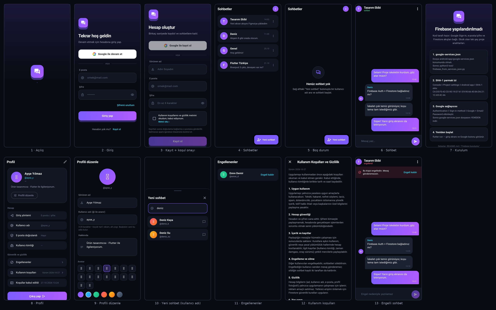

# Rebelz Media — Sohbet (Flutter + Firebase)


Koyu temalı bir sohbet uygulaması. Backend: **Firebase Authentication
(Google Sign-In + e-posta/şifre)** ve **Cloud Firestore**.

**Öne çıkanlar (v0.2.0)**

- Kullanıcı adıyla **kişi arama** → doğrudan sohbet (oda adı sorulmaz)
- **Profil düzenleme**: görünen ad, `@kullanıcı adı`, hakkında, avatar
  (emoji + renk) ve fotoğraf bağlantısı
- **Sohbet silme**: sadece benden kaldır ya da tüm mesajlarla kalıcı sil
- **Kişi engelleme / engel kaldırma**
- **E-posta doğrulama**: kayıtta otomatik gönderim + "tekrar gönder / doğruladım"
- **Kullanım koşulu onayı**: kayıtta zorunlu onay kutusu; onay zaman damgası
  ve sürümü değiştirilemez kayıt olarak saklanır

Ayrıntılar: [docs/eposta-dogrulama-ve-onay.md](docs/eposta-dogrulama-ve-onay.md) ·
[docs/profil-sohbet-engelleme.md](docs/profil-sohbet-engelleme.md)



> Sıra (üst sıra): açılış · giriş · kayıt + koşul onayı · sohbetler · boş durum · sohbet · kurulum
> Sıra (alt sıra): profil · profili düzenle · yeni sohbet (kullanıcı adı) · engellenenler · kullanım koşulları · engelli sohbet
>
> Görseller CI'da gerçek Flutter render'ıyla üretilir
> (`Ekran görüntüleri` workflow'u → `test_preview/preview_test.dart --update-goldens`)
> ve tek tek `docs/ekranlar/` altına yazılır. Emoji'ler CI'da yazı tipi
> olmadığı için kutu görünebilir; cihazda normal emoji olarak çizilir.

| | |
|---|---|
| **Firebase projesi** | `rebelz-media` |
| **Android paketi** | `com.rebelz.media` |
| **App ID** | `1:824723400047:android:4f0919a943290bf905749a` |
| **Kayıtlı SHA-1 (debug)** | `CA:D5:F0:42:CD:90:19:D7:61:E9:90:66:40:8A:D6:21:1C:A9:4C:4A` |
| **Kayıtlı SHA-1 (release/upload)** | `2E:96:3D:A6:63:06:D1:8F:34:A8:E5:1A:BD:7C:24:F1:41:B8:6E:8D` |
| **Flutter** | 3.35+ · **JDK** 17 · **Android SDK** 36 |

## Hızlı başlangıç

```bash
flutter pub get
flutter run            # cihaz/emülatör
flutter analyze        # statik analiz
flutter test           # 6 test
```

APK üretmek için iki yol var — ikisi de ayrıntılı olarak
[docs/KURULUM.md](docs/KURULUM.md) içinde:

**1) GitHub Actions (kurulum gerekmez, önerilen)**

`.github/workflows/build-apk.yml` hazır. Depoda **Actions** → **APK derle** →
**Run workflow**. ~6 dakika sonra **Artifacts** → `sohbet-apk`:

- `app-release.apk` — telefona kuracağın sürüm
- `app-debug.apk` — emülatör/eski cihazlar

Workflow `flutter analyze` + `flutter test` de çalıştırır; kırmızı olursa
artifact üretilmez. Son adım `apksigner` ile **APK'nın gerçek imzasını** doğrular
ve SHA-1/SHA-256'yı workflow özetine yazar.

**2) Kendi makinenizde**

```bash
flutter build apk --release   # build/app/outputs/flutter-apk/app-release.apk
```

> Bu depo 2 GB RAM'li bir ortamda hazırlandı; `flutter build apk` orada OOM
> (exit 137) ile düştüğü için `android/gradle.properties` içinde daemon kapalı
> ve Kotlin derleyicisi in-process. Varsayılan heap CI için `-Xmx2048m`;
> ≤2 GB RAM'li bir makinede derlerken dosyanın başındaki `-Xmx640m` +
> `org.gradle.workers.max=1` kombinasyonuna geçin. Release'te R8 küçültme kapalı.
> İmza: upload anahtarı varsa onunla, yoksa debug anahtarıyla
> ([Release imzalama](#release-imzalama) bölümüne bakın).

## Depo yapısı

```
.
├── lib/
│   ├── main.dart                     # Firebase init (iki yol: options ya da native config)
│   ├── firebase_options.dart         # tool/ script'i üretir
│   ├── core/
│   │   ├── config/google_sign_in_config.dart   # Web client ID
│   │   ├── router/                   # go_router + AuthNotifier
│   │   ├── services/auth_service.dart# Google + e-posta/şifre + profil upsert
│   │   ├── theme/                    # koyu tema
│   │   └── widgets/                  # AppLogo, GoogleLogo, GoogleSignInButton, ...
│   └── features/
│       ├── auth/presentation/        # splash, login, register
│       ├── chat/{data,domain,presentation}   # repository, modeller, sohbet ekranları
│       ├── profile/{data,domain,presentation} # profil, kullanıcı adı, koşullar, engelleme
│       └── setup/                    # anahtarlar eksikse rehber ekranı
├── android/                          # com.rebelz.media (google-services.json dahil)
├── ios/  web/
├── test/                             # 6 widget/model testi
├── test_preview/                     # golden önizleme testi (docs/screens.png kaynağı)
├── tool/firebase_from_services_json.py   # google-services.json → Dart yapılandırması
├── firestore.rules
├── docs/                             # ekran görüntüleri, kurulum rehberi, imza izleri
├── anahtarlar/                       # upload-keystore.p12 + parola (git dışı)
└── .github/workflows/build-apk.yml   # APK derleme + test workflow'u
```

## Release imzalama

Release APK'nın imzası `android/app/build.gradle.kts` içinde iki kaynaktan
beslenir — ilk bulunan kullanılır:

| Kaynak | Nerede | İçerik |
|---|---|---|
| `android/key.properties` | yerel makine (`.gitignore`'da) | `storeFile=upload-keystore.p12`, `storePassword`, `keyAlias=upload`, `keyPassword` |
| Ortam değişkenleri | CI | `KEYSTORE_PATH`, `KEYSTORE_PASS`, `KEY_ALIAS`, `KEY_PASS` |

`storeFile` yolu `android/app/` altına göredir. İkisi de yoksa derleme
**kırılmaz**, release APK debug anahtarıyla imzalanır (CI özetinde ⚠️ işaretlenir).

**CI'da upload anahtarıyla imzalamak için** — GitHub → *Settings → Secrets and
variables → Actions*:

| Secret | Değer |
|---|---|
| `KEYSTORE_B64` | `base64 -w0 anahtarlar/upload-keystore.p12` |
| `KEYSTORE_PASS` | anahtar deposu parolası |
| `KEY_ALIAS` | `upload` |
| `KEY_PASS` | anahtar parolası — **`KEYSTORE_PASS` ile aynı olmalı** (depodaki anahtar PKCS#12'dir, tek parola kullanır) |

Workflow bu secret'ları `android/app/upload-keystore.p12` + `android/key.properties`
olarak açar (ikisi de git dışı) ve derlemeden **önce** doğrular:

- base64 çözümü + p12 boyutu (4384 bayt) + sha256 sabitleri
- `keytool` ile store parolası ve alias
- `openssl` ile **private key'in parolayla açılabildiği** (Gradle'ın
  `Given final block not properly padded` hatası burada yakalanır)

Herhangi biri tutmazsa koşu **hata vererek** durur — sessizce debug imzaya
düşmez. Secret tanımlı değilse adım atlanır, APK debug anahtarıyla imzalanır.
`KEY_PASS` farklı bir değere ayarlıysa uyarı verilir ve PKCS#12 tek parola
kuralı gereği `KEYSTORE_PASS` kullanılır.

> **Doğrulanmış durum:** CI'da derlenen `app-release.apk`, upload anahtarıyla
> imzalı — `certificate SHA-1 digest: 2e963da66306d18f34a8e51abd7c24f141b86e8d`
> (Firebase'de kayıtlı `2E:96:3D:A6:…:6E:8D`).

İmzayı doğrulama:

```bash
apksigner verify --print-certs build/app/outputs/flutter-apk/app-release.apk
# Signer #1 certificate SHA-1 digest: 2e963da66306d18f34a8e51abd7c24f141b86e8d
```

## Firebase tarafı

- Android uygulaması `com.rebelz.media` olarak kayıtlı; **iki** SHA-1 eklendi:
  debug (`CA:D5:F0:42:…:4C:4A`) ve release/upload (`2E:96:3D:A6:…:6E:8D`)
- `google-services.json` bu iki Android OAuth istemcisini + Web istemcisini içeriyor
- Google ve Email/Password giriş yöntemleri etkin
- `google-services.json` → `android/app/google-services.json` (repoda)
- `lib/firebase_options.dart` gerçek değerlerle dolu
- Web client ID → `lib/core/config/google_sign_in_config.dart`

Firestore kurallarını yayınlayın:

```bash
npx -y firebase-tools@latest deploy --only firestore:rules --project rebelz-media
```

`google-services.json` değiştiğinde (yeni SHA-1, yeni istemci) yapılandırmayı
yenileyin:

```bash
python3 tool/firebase_from_services_json.py --check   # Web client ID geldi mi?
python3 tool/firebase_from_services_json.py           # firebase_options + Web client ID yaz
```

### 🔐 Güvenlik notu (depo public)

`google-services.json` ve `lib/firebase_options.dart` içindeki değerler
**istemci yapılandırmasıdır** (Firebase API anahtarı sır değildir; güvenlik
Firestore kuralları ve Authentication ile sağlanır) — bu yüzden repoya dahil.
Yine de public bir repoda önerilenler:

- Google Cloud Console → **APIs & Services → Credentials** → Android/iOS
  anahtarlarını uygulama kısıtlamasıyla (paket adı + SHA-1) sınırlayın,
  tarayıcı anahtarını yalnızca izinli domainlerle.
- `firestore.rules` dosyasını mutlaka yayınlayın (test modu kuralları açık bırakmayın).
- **Özel anahtarlar repoda yok:** `*.jks`, `*.keystore` ve `android/key.properties`
  `.gitignore` içinde.


Firebase'de **iki** parmak izi kayıtlı: debug (`CA:D5:F0:42:…`) ve
release/upload (`2E:96:3D:A6:…`). **Senin bilgisayarındaki Flutter kendi debug
keystore'unu oluşturur ve parmak izi farklıdır**; GitHub Actions her koşuda yeni
bir keystore üretir. Google girişi `ApiException: 10` verirse o ortamın SHA-1'ini
Firebase'e ek fingerprint olarak ekle (mevcutlar silinmesin, yan yana durabilir):

```bash
keytool -list -v -keystore ~/.android/debug.keystore -alias androiddebugkey \
  -storepass android | grep SHA1
```

Windows: `%USERPROFILE%\.android\debug.keystore`. Keystore yoksa bir kez
`flutter run` çalıştırınca oluşur.

> **Not:** Anahtar dosyaları (`*.jks`, `*.keystore`, `*.p12`) **repoya
> eklenmez** — public repoda özel anahtar tutulmaz. Release anahtarı yerelde
> `anahtarlar/upload-keystore.p12` (git dışı) durur; parolası ve kullanım
> adımları `anahtarlar/OKUBENI.txt`. Tüm parmak izleri ve doğrulama komutları:
> [docs/imza-parmak-izleri.txt](docs/imza-parmak-izleri.txt).

## Google Sign-In akışı (kod)

`lib/core/services/auth_service.dart`:

- **Android/iOS:** `GoogleSignIn.instance.initialize(serverClientId: ...)` →
  `authenticate()` → `idToken` → `GoogleAuthProvider.credential(idToken:)` →
  `signInWithCredential`.
- **Web:** `GoogleSignIn` hiç başlatılmaz; `signInWithPopup(GoogleAuthProvider())`
  kullanılır (aksi halde DWDS sonsuz bekler). Web'de `signOut()` de çağrılmaz.
- Kullanıcı vazgeçerse (`GoogleSignInExceptionCode.canceled`) hata gösterilmez,
  akış sessizce biter.
- Başarılı girişte `users/{uid}` dokümanı `displayName` / `email` / `photoUrl` /
  `lastSeenAt` ile upsert edilir.

**`main.dart` iki yolu destekler:**

1. `lib/firebase_options.dart` dolduysa → `Firebase.initializeApp(options: ...)`
2. Boşsa ama `google-services.json` varsa → `Firebase.initializeApp()`
   (native yapılandırma okunur — Android'de çalışır, web'de çalışmaz)

İkisi de yoksa uygulama çökmez, kurulum rehberi ekranını gösterir.

## Firestore veri modeli

```
users/{uid}
  displayName, displayNameLower, username, usernameLower, bio,
  photoUrl, avatarEmoji, avatarColor, email, emailVerified,
  termsVersion, termsAcceptedAt, createdAt, lastSeenAt
  ├─ consents/{id}    uid, email, version, accepted, platform, acceptedAt
  └─ blocked/{uid}    blockedUid, createdAt

usernames/{usernameLower}      uid, usernameLower, createdAt   (tekillik kilidi)

rooms/{roomId}
  name, photoUrl, type ('dm'|'group'), createdBy, memberIds[],
  lastMessage, lastMessageAt, hiddenFor[], memberNames, createdAt
  └─ messages/{messageId}
       senderId, senderName, senderPhotoUrl, text, type, createdAt
```

Kurallar `hasOnly` ile alan beyaz listesi uygular: `users` güncellemesinde
yalnızca profil alanları değişebilir; `consents` kayıtları oluşturulduktan
sonra değiştirilemez/silinemez (kanıt); mesaj içeriği düzenlenemez, yalnızca
sohbet silme akışında silinebilir. Mesaj yazımı, karşı taraf sizi
engellediyse kural tarafından reddedilir.

## Test ve önizleme

```bash
flutter analyze    # 0 issue
flutter test       # birim + widget testleri (profil, kullanıcı adı, koşul onayı)
flutter test test_preview/preview_test.dart --update-goldens   # docs/screens.png kaynağı
```

| Kontrol | Sonuç |
|---|---|
| `flutter analyze` | ✅ 0 sorun |
| `flutter test` | ✅ 6/6 test |
| `flutter build web --release` | ✅ başarılı |
| `flutter build apk` | ❌ bu ortamda OOM (2 GB RAM) — Actions/kendi makineniz |

## Sorun giderme

| Belirti | Sebep / çözüm |
|---|---|
| `ApiException: 10` (DEVELOPER_ERROR) | SHA-1 Firebase'e eklenmemiş ya da yanlış paket adı |
| `idToken` null | `google-services.json` içinde `client_type: 3` yok → Google sağlayıcısını etkinleştir, dosyayı yeniden indir |
| `auth/unauthorized-domain` (web) | Authentication → Settings → Authorized domains'e alan adını ekle (port yazma) |
| `operation-not-allowed` | İlgili sağlayıcı konsolda etkin değil |
| Kurulum ekranı geliyor | `google-services.json` yok/yanlış konumda ya da `firebase_options.dart` boş |

## Sırada

- [x] Release keystore SHA-1'ini Firebase'e ekleme (`2E:96:3D:A6:…:6E:8D`)
- [x] Release imzalamayı `build.gradle.kts`'e bağlama (`key.properties` / `KEYSTORE_*`)
- [ ] Secret'ları GitHub'a tanımlama + Play Store'a yükleme (`.aab`, Play App Signing)
- [ ] iOS uygulamasını kaydetme (`GoogleService-Info.plist`, `REVERSED_CLIENT_ID`)
- [x] `users` koleksiyonundan fotoğraf gösterimi (avatar `photoUrl` destekler)
- [ ] Mesaj sayfalama (şu an son 100 mesaj), okundu bilgisi, FCM bildirimleri
- [x] Sohbet odalarını `memberIds` ile sınırlama
- [ ] Galeriden fotoğraf yükleme (Firebase Storage + `image_picker`)

---

Ayrıntılı kurulum/derleme adımları: [docs/KURULUM.md](docs/KURULUM.md)
